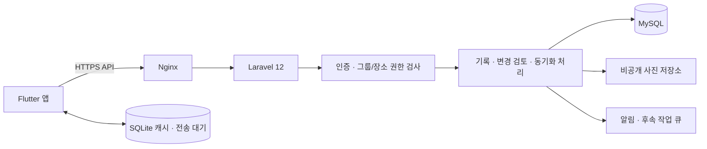
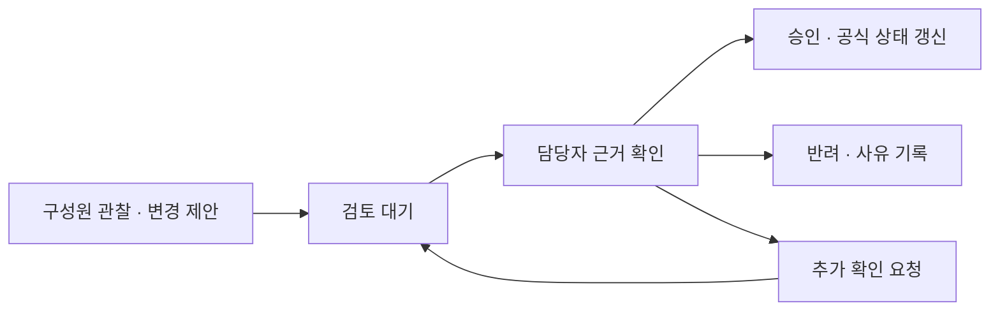

# 스트릿캣 공동 돌봄 전환 기획제안서

작성일: 2026년 10월 26일  
버전: 제안 v1.0  
확인된 서버 환경: MySQL + Laravel 12 + Nginx  
문서 범위: 제품 구조·인증·공유 권한·상태 변경 절차·API 및 데이터 구조 제안

> 이 문서는 개인 돌봄 중심의 기존 고도화 기획보다 먼저 적용할 공동 돌봄 전환 기준이다. 실제 MySQL 버전, 기존 서버 스키마, 인증·저장소 구성은 아직 확인하지 않았다. 아래 정책과 API는 구현 전 검토할 제안이며, 현재 앱에 구현됐다는 뜻이 아니다.

## 1. 핵심 제안

스트릿캣의 기본 단위를 **개인 계정이 보유한 기록**에서 **돌봄 그룹이 함께 관리하는 장소·친구·기록**으로 변경한다.

| 과제 | 권장 방향 |
|---|---|
| 앱과 서버 DB 연결 | Flutter는 HTTPS API를 호출하고, Laravel이 인증·권한·업무 규칙을 검사한 뒤 MySQL을 처리 |
| 공동 데이터 | 그룹 안에서 장소와 친구를 공유하고, 친구–장소는 다대다 관계 유지 |
| 가입과 위치 보호 | 휴대폰 번호 확인 + 초대 또는 가입 신청 + 운영자 승인 + 장소별 권한 부여 |
| 친구 상태 변경 | 구성원의 관찰 기록과 공식 상태를 분리하고, 주요 변경은 제안·검토·확정 절차 적용 |
| 동시 수정 | 서버 버전 검사와 트랜잭션으로 충돌을 막고 변경 이력 보관 |
| 기존 로컬 앱 | SQLite는 기기 캐시·작성 중 기록·전송 대기 용도로 전환하고 공유 데이터의 공식 값은 서버에서 관리 |

**휴대폰 번호 확인만으로 장소를 공개하지 않는다. 승인된 사람에게도 담당 장소만 제공하고, 관찰 한 번으로 공식 상태가 덮어써지지 않게 한다.**

## 2. 개인 중심에서 공동 돌봄 중심으로

### 2.1 서비스의 기본 단위

- **사용자**: 로그인하는 사람. 한 사람이 여러 그룹에 참여할 수 있다.
- **돌봄 그룹**: 함께 돌보는 운영 단위. 장소·친구·기록의 소속과 공유 정책을 결정한다.
- **돌봄장소**: 그룹에 속하며 열람·기록·운영 권한을 부여하는 단위다.
- **친구**: 그룹이 관리하는 고양이. 같은 그룹의 여러 장소에 연결할 수 있다.
- **돌봄 기록**: 누가 어느 장소에서 언제 무엇을 했는지 남긴 사실 기록이다.
- **공식 상태**: 검토를 거쳐 확정한 친구의 생애주기·TNR 상태다.

첫 출시에서는 장소와 친구가 각각 하나의 그룹에 소속되도록 한다. 서로 다른 그룹의 친구를 이름이나 묘색만으로 자동 병합하지 않는다. 같은 고양이라는 판단과 그룹 간 공유는 별도 후속 기능으로 다룬다.

### 2.2 데이터 소속과 작성자

- 장소·친구의 공동 관리 정보는 그룹에 소속한다.
- 개별 기록에는 작성자, 관찰 시각, 서버 접수 시각을 구분해 보관한다.
- 구성원이 탈퇴해도 공동 돌봄의 연속성을 위해 기록을 유지할지, 작성자 표시를 어떻게 처리할지 운영 정책을 정한다. 계정 개인정보 삭제와 공동 기록 보관은 구분해 설계한다.
- 기존 개인 기록은 사용자가 선택한 그룹으로 명시적으로 이관한다. 가입만으로 기기의 모든 기록을 업로드하지 않는다.

### 2.3 여러 장소의 같은 친구

예: 나비가 공원과 주차장에 연결되면 두 장소의 승인된 돌봄 구성원이 같은 친구 ID를 사용한다.

- 어느 장소에서 남긴 목격인지 기록에 포함한다.
- 친구 수와 공식 상태는 하나로 관리한다.
- 친구의 공식 건강·투약·TNR 요약은 해당 친구를 볼 수 있는 구성원에게 공유해 서로 다른 판단과 중복 조치를 줄인다.
- 다른 장소의 좌표·주소·현장 설명·원본 사진은 별도의 장소 권한을 검사한다. 친구를 볼 수 있다는 이유만으로 모든 연결 장소를 반환하지 않는다.
- 친구 담당자는 그 친구의 연결 장소를 검토할 수 있는 권한을 가진 사람으로 지정한다.

## 3. 서버 처리 방식

### 3.1 권장 구조

### 3.2 API와 앱 직접 처리 비교

| 방식 | 장점 | 문제와 적용 판단 |
|---|---|---|
| 앱에서 MySQL에 직접 접속 | 초기 실험 코드가 짧을 수 있음 | 접속 정보가 앱에 포함되고, 권한·승인·동시 수정 규칙을 신뢰할 수 있는 곳에서 통제하기 어려움. 이 서비스에는 채택하지 않음 |
| Laravel API를 통해 MySQL 처리 | 사용자·장소별 권한, 승인, 이력, 충돌 처리를 한곳에서 적용 가능 | API 구현과 운영이 필요하지만 현재 서버 환경과 요구사항에 가장 적합 |
| 인증·권한 정책을 갖춘 BaaS의 클라이언트 SDK | 별도 서버 코드를 일부 줄일 수 있음 | 일반 MySQL 직접 접속과는 다른 구조. 현재 Laravel/MySQL을 유지하는 조건에서는 전환 이점 검토가 먼저 필요 |

권장안은 **Laravel API 방식**이다. 앱은 화면 표시와 입력을 담당하고, 신뢰가 필요한 판단은 서버에서 수행한다. BaaS도 클라이언트에서 관리자 비밀 키를 사용하는 방식은 허용하지 않는다. [Supabase 공식 보안 안내](https://supabase.com/docs/guides/database/secure-data)

### 3.3 각 계층의 역할

| 계층 | 역할 |
|---|---|
| Flutter | 입력·조회·작성 중 저장·허용된 캐시 표시·동기화 상태 표시 |
| Nginx | HTTPS 종료, 요청 크기·기본 호출량 제한, Laravel로 전달. 공개 웹 경로에 원본 사진을 직접 노출하지 않음 |
| Laravel | 인증, 그룹·장소·필드별 권한, 입력 검증, 상태 변경 검토, 데이터 이관, 사진 접근 통제, 감사 이력 |
| MySQL | 공식 데이터·관계·버전·승인 이력 저장, 트랜잭션과 고유 제약으로 일관성 유지 |
| 작업 큐 | 알림 발송, 공유용 사진 생성, 리포트 생성 등 후속 작업. 승인 결과 저장과 알림 실패를 분리 |

기존 MySQL 데이터를 먼저 점검하고 필요한 테이블과 컬럼을 추가한다. 현재 Flutter의 SQLite 스키마를 서버에 그대로 복사하는 방식으로 진행하지 않는다.

## 4. 휴대폰 인증과 가입 승인

### 4.1 추천 절차

1. 휴대폰 번호 입력과 SMS 일회용 코드 확인.
2. 계정 생성 또는 로그인.
3. 초대 링크·초대 코드 사용 또는 운영자에게 가입 신청.
4. 운영자가 신청자의 돌봄 관계를 확인하고 가입 승인.
5. 운영자가 열람·기록 가능한 장소를 명시적으로 선택.
6. 부여받은 장소와 그 장소의 친구만 앱에 표시.

**전화번호 확인, 그룹 가입 승인, 장소 접근 허용은 서로 다른 상태다.**

가입 대기 중에는 장소 목록·지도 핀·사진·친구 정보가 나오지 않는다. 초대 링크의 미리보기에도 주소와 좌표를 넣지 않는다. 전화번호 확인 전에는 초대를 최종 소비하거나 가입 권한을 부여하지 않는다.

### 4.2 휴대폰 확인의 역할과 한계

SMS 코드는 그 시점에 해당 번호로 코드를 받을 수 있는지를 확인한다. 번호를 확인했다는 사실만으로 선의의 돌봄 구성원임을 보장하지 않으므로 운영자의 관계 확인이 추가로 필요하다. NIST도 SMS 등 전화망 기반 인증에서 SIM 변경과 번호 이동 등의 위험을 고려하도록 안내한다. [NIST SP 800-63B-4](https://pages.nist.gov/800-63-4/sp800-63b.html)

| 방법 | 제안 |
|---|---|
| SMS 번호 확인 | 기본 가입·로그인 절차로 사용. 번호 소유 확인과 법적 실명 본인확인을 혼동하지 않도록 화면 명칭 구분 |
| 기존 구성원의 초대·추천 | 승인 담당자가 신청자를 확인할 단서로 사용. 추천만으로 장소 권한을 자동 부여하지 않음 |
| 운영자 승인 | 신규 구성원의 접근 범위를 결정하는 기본 절차 |
| 관리자 추가 인증 | 구성원 승인·권한 확대·주요 상태 확정 등 민감한 작업에 추가 인증 적용. 인증 앱 등 지원 방법은 도입 시 결정 |
| PASS 등 별도 본인확인 | 실명 확인이 실제 운영에 필요한지, 비용과 개인정보 수집 범위를 검토한 뒤 선택. 번호 확인을 대체하는 신뢰·가입 승인 수단으로 보지 않음 |

### 4.3 인증 운영 정책 초안

다음 수치는 초기 제안이며 실제 이용량과 문자 발송 비용을 보고 조정한다.

- 인증 코드 유효기간 3분, 재전송 간격 60초, 코드 입력 실패 5회 후 해당 인증 요청 만료.
- 번호·사용자·기기·IP별 호출량을 함께 제한한다. 통신사 공용 IP만으로 정상 사용자를 일괄 차단하지 않는다.
- 일별 문자 발송 예산과 비정상 발송량 감지를 둔다.
- 코드와 인증 토큰을 로그에 남기지 않는다. 전화번호는 다른 구성원에게 기본 비공개로 두고 운영 화면에서도 필요한 범위만 마스킹해 표시한다.
- 앱은 SMS 업체의 발송 비밀 키를 보유하지 않는다.
- 계정 복구를 새 번호 확인만으로 완료하지 않는다. 번호 변경·새 기기 로그인에는 기존 인증 수단 또는 별도 복구 절차를 적용한다.
- 기존 기기 목록 확인과 분실 기기 로그아웃을 제공한다. 번호 재할당과 계정 양도를 전제로 복구 정책을 설계한다.

SMS 인증에는 발송 남용과 비용 공격 대응도 필요하다. [Google Identity Platform 안내](https://docs.cloud.google.com/identity-platform/docs/sign-in-user-phone)

### 4.4 Laravel 인증 구성

모바일 API 인증은 Laravel Sanctum을 우선 검토한다. SMS 코드 검증과 계정 연결은 별도의 인증 로직이며, 검증 성공 후 Sanctum 토큰을 발급하는 구조다. Sanctum 자체가 SMS 발송과 신뢰 심사를 수행하는 것으로 설계하지 않는다.

Sanctum은 모바일 API 토큰을 지원하며 토큰 만료와 폐기 정책을 설정할 수 있다. 기본 토큰이 자동 만료되지 않으므로 서비스 정책에 맞는 만료를 명시하고 기기별 폐기 기능을 구현한다. 예를 들어 초기 일반 기기 토큰은 7일 만료로 시작해 사용성과 비용을 검증한다. 자동 갱신이 필요하면 별도의 안전한 갱신 절차를 설계하며, 이를 Sanctum의 기본 기능으로 가정하지 않는다. [Laravel 12 Sanctum](https://laravel.com/docs/12.x/sanctum)

기존 PIN·생체인증은 기기 안에서 앱을 잠그는 용도로 유지한다. 서버 API의 사용자 인증과 변경 승인 권한은 서버에서 별도로 확인한다.

## 5. 장소·친구 공유 권한

### 5.1 역할 초안

| 역할 | 열람 | 현장 기록 | 공식 상태 | 구성원·권한 관리 |
|---|---|---|---|---|
| 가입 대기자 | 그룹·장소의 비공개 데이터 접근 불가 | 불가 | 불가 | 불가 |
| 열람 구성원 | 승인된 장소와 연결 친구 | 불가 | 변경 불가 | 불가 |
| 돌봄 구성원 | 승인된 장소와 연결 친구 | 돌봄·목격·관찰 보고, 자기 기록 정정 | 변경 제안 | 불가 |
| 장소·친구 담당자 | 담당 범위 | 기록 및 검토 | 담당 범위에서 승인·반려 | 새 구성원·권한 부여는 운영자에게 요청 |
| 그룹 운영자 | 그룹 운영에 필요한 전체 범위 | 운영·검토 | 지정된 범위의 승인·반려 | 초대·승인·장소 권한·담당자 지정·활동 정지 |

운영자도 다른 그룹의 정보를 볼 수 없다. 일반 상태 변경 절차를 건너뛰는 무제한 수정 버튼은 제공하지 않는다. 서비스 운영자의 긴급 지원 접근은 일반 그룹 운영자와 별도로 제한·기록한다.

### 5.2 실제 권한 판단

그룹 역할만으로 모든 장소를 열어 주지 않는다. **활성 계정 + 활성 그룹 참여 + 대상 장소 권한 + 작업별 권한**을 함께 확인한다.

- 초대는 가입 신청 자격이며 장소 권한 자체가 아니다.
- 신규 승인 시 장소 권한은 기본 없음으로 두고 운영자가 필요한 장소를 선택한다.
- 지도·검색·친구 상세·사진·통계·리포트·내보내기에 같은 권한 규칙을 적용한다.
- 앱에서 버튼을 숨기는 것 외에 Laravel Policy와 서비스 계층에서 요청마다 권한을 검사한다.
- URL의 그룹 ID와 실제 장소·친구·파일의 소속이 일치하는지도 검사한다.
- 같은 그룹의 다른 장소라도 권한이 없다면 주소·좌표와 원본 자료를 내려보내지 않는다.
- 공유 친구의 상태 변경 제안은 그 친구를 볼 수 있는 사람이 할 수 있지만, 검토자는 연결 장소의 상황을 확인할 수 있도록 별도로 지정한다.

기본 거부와 모든 요청의 권한 검사는 OWASP의 권고를 따른다. Laravel Policy는 자원별 권한 로직을 모으는 수단으로 사용한다. [OWASP 권한 가이드](https://cheatsheetseries.owasp.org/cheatsheets/Authorization_Cheat_Sheet.html), [Laravel 12 Authorization](https://laravel.com/docs/12.x/authorization)

### 5.3 위치와 사진 노출 방지

- 별도의 ‘정밀 위치 열람’ 메뉴를 되살리는 대신, 일반 지도와 모든 API 응답에 장소 권한을 공통 적용한다.
- 좌표와 상세 주소는 제한된 응답·저장 경로에서 다루고, 권한이 없는 응답에는 필드를 포함하지 않는다.
- 장소 별명·접근 메모·사진 배경·EXIF GPS도 위치를 드러낼 수 있으므로 공유 범위에 포함해 검토한다.
- 사진은 비공개 저장소에 둔다. 인증된 파일 조회 API에서 현재 권한을 검사한 뒤 전달하는 방식을 우선한다.
- 공유용 사진은 EXIF 위치 정보를 제거한 사본을 사용하고, 민원·위험 증빙 원본은 별도 권한으로 보관한다. 원본 파일과 공유용 사본을 구분한다.
- 공개 영구 사진 URL을 제공하지 않는다. 단기 다운로드 URL을 사용할 경우 만료 전까지의 접근 가능 시간과 폐기 한계를 명시한다.
- 푸시 알림과 잠금화면에는 주소·좌표·민감한 상태 상세를 넣지 않고, 앱에서 인증 후 내용을 조회한다.
- 단순 좌표 반올림만으로 안전하게 익명화됐다고 판단하지 않는다.

### 5.4 정지·탈퇴·권한 회수

- 정지와 장소 권한 회수는 다음 온라인 API 요청부터 반영되도록 한다. 토큰에 저장된 과거 역할만 신뢰하지 않는다.
- 공유 데이터 캐시와 사진은 권한 회수 사실을 받은 뒤 해당 범위에서 정리한다.
- 이미 내려받은 자료, 스크린샷, 오프라인 기기의 사본을 서버가 확실히 회수할 수 있다고 약속하지 않는다.
- 이 한계를 줄이기 위해 신규 구성원에게 필요한 장소만 허용하고, 전체 내보내기 권한은 기본적으로 운영자로 제한한다.

## 6. 친구 상태를 여러 사람이 바꿀 때의 운영 방식

### 6.1 ‘관찰’과 ‘공식 상태’ 분리

**관찰 기록은 빠르게 추가하고, 공식 상태는 검토해서 확정한다.**

예: 구성원이 “오늘 나비가 안 보임”을 남기면 그 목격 기록은 바로 공유한다. 이것만으로 공식 상태를 ‘실종 의심’으로 바꾸지 않고, 마지막 목격과 최근 관찰을 담당자가 함께 검토한다.

친구 상세에는 다음 두 영역을 구분한다.

- 공식 상태: 활동 중, 실종 의심, 구조·입양, 이사, 별이 됨 / 확정된 TNR 단계.
- 최근 보고: 목격·증상·현장 사진·상태 변경 제안과 검토 상태.

긴급한 관찰 보고는 검토가 끝날 때까지 숨기지 않는다. ‘미확인 보고’ 배지로 바로 알리면서 공식 상태는 별도로 유지한다.

### 6.2 변경 종류별 처리

| 대상 | 구성원이 할 수 있는 일 | 확정 방식 |
|---|---|---|
| 돌봄·목격 사실 | 자기 기록 추가 | 즉시 반영. 다른 사람 기록 덮어쓰기 금지 |
| 증상·위험 발견 | 관찰 보고와 사진 첨부 | 미확인 보고로 즉시 공유, 확인 담당자 표시 |
| 실제 투약 사실 | 권한 있는 구성원의 투약 기록 추가 | 즉시 공유하고 최근 투약과 함께 표시. 투약 계획 변경과는 구분 |
| 이름·묘색 등 프로필 | 수정 제안 | 지정 담당자 검토 |
| 친구–장소 연결 | 연결·해제 제안 | 친구 담당자가 관련 장소 권한을 확인한 뒤 승인 |
| 활동 중·실종 의심 | 상태 변경 제안 | 최근 목격과 기간을 확인해 담당자가 승인 |
| 구조·입양·이사·별이 됨 | 날짜·사유·확인 근거를 포함한 제안 | 제안자와 다른 지정 검토자 1명의 승인 필수 |
| TNR 포획 예정·수술·방사·완료 | 단계·날짜·근거를 포함한 제안 | TNR 담당자 검토. 완료는 확인 근거를 함께 보관 |
| 공유 장소의 좌표 변경·폐쇄 | 사유와 변경 제안 | 해당 장소의 지정 검토자가 확인 |

미목격 기간과 투표 수만으로 ‘사망’ 같은 상태를 자동 확정하지 않는다. 개인의 관찰은 관찰로 남기고, 공식 상태에는 확인 책임자를 둔다.

### 6.3 검토 절차

- 제안에는 대상, 변경 전 값과 버전, 제안 값, 관찰 시각, 사유, 관련 기록을 포함한다.
- 검토자는 제안자와 달라야 한다. 제안자가 검토 권한을 가졌더라도 자기 제안을 승인할 수 없다.
- 승인·반려·추가 확인 요청에 담당자와 처리 시각을 기록한다.
- 대기 중인 제안은 공식 상태와 별도로 표시한다.
- 이미 확정한 상태를 정정할 때도 새 정정 제안과 이력을 만든다.
- 같은 친구의 상태 제안은 한곳에 모아 담당자가 상충하는 내용을 함께 볼 수 있게 한다.
- 신뢰는 단순 ‘좋아요’나 다수결 점수로 확정하지 않는다.

### 6.4 작은 그룹의 운영

중요 상태를 확정하려면 최소 두 명이 관여하도록 한다. 그룹 운영자와 다른 검토 담당자 한 명을 지정하는 운영을 권장한다.

검토자가 없는 1인 그룹도 개인 관찰을 남길 수 있지만, 독립 검토가 필요한 공동 공식 상태 변경은 확인 대기로 둔다. 기다리는 동안 관찰·긴급 보고는 구성원이 확인할 수 있다. 초기 데이터 이관과 신규 장소의 비공개 초안 작성은 이 검토 절차와 구분한다.

규모가 큰 그룹은 중요 변경에 제안자 외 검토자 두 명을 요구하도록 확장할 수 있다. 검토 기준을 낮추는 예외 기능은 MVP에 넣지 않고 운영 경험을 보고 별도 결정한다.

### 6.5 정정과 분쟁

- 다른 사람의 기록을 직접 수정하는 대신 정정 요청과 보완 기록을 남긴다.
- 작성자의 자기 기록 정정에도 이전 내용과 정정 이유를 남긴다.
- 민감한 증빙은 필요한 검토자만 열람하며, 공개용 요약과 원본 자료를 구분한다.
- 이견이 있으면 친구에 ‘상태 확인 중’ 배지를 표시하고 기존 공식 상태와 검토 대기 내용을 함께 보여 준다. 이 배지는 공식 생애주기 값을 임의로 바꾸는 기능이 아니다.
- 운영자는 부적절한 자료를 숨기고 활동을 정지할 수 있지만, 그 조치에도 사유와 이력을 남긴다.
- 이력 보존은 일반 앱 사용자의 덮어쓰기를 막는 설계다. DB 운영자까지 포함한 절대적인 위변조 불가능성을 보장하는 표현은 사용하지 않는다.

## 7. 동시 수정과 오프라인 처리

### 7.1 공식 상태의 동시 변경

1. 앱이 공식 상태와 `version`을 조회한다.
2. 변경 제안은 조회한 버전을 기준으로 제출한다.
3. 승인 시 서버가 현재 버전, 제안 상태, 검토자의 최신 권한을 다시 검사한다.
4. 트랜잭션 안에서 대상·제안과 관련 계정·멤버십·권한 행 또는 권한 버전을 검사·잠그고 상태 갱신·이력·버전 증가를 함께 처리한다. 권한 회수도 같은 검사·잠금 규칙을 사용하고 잠금 순서를 통일한다.
5. 다른 변경이 먼저 확정됐다면 `409 Conflict`를 반환하고 재검토한다.

따라서 늦게 도착한 수정이 최신 상태를 덮어쓰지 않는다. Laravel의 트랜잭션과 `lockForUpdate` 같은 잠금 기능을 조합할 수 있다. 실제 MySQL 엔진·인덱스·트랜잭션 설정을 확인한 뒤 구현한다. [Laravel 12 데이터베이스](https://laravel.com/docs/12.x/database), [Laravel 12 쿼리 잠금](https://laravel.com/docs/12.x/queries#pessimistic-locking)

### 7.2 일상 기록과 중복 전송

- 요청마다 사용자·그룹·작업 범위에 묶인 `client_event_id`를 사용한다.
- 같은 요청을 재전송하면 같은 결과를 반환하고 기록을 중복 생성하지 않는다.
- 같은 ID로 다른 내용이 오면 충돌로 처리한다. 재전송 결과 반환 전에도 현재 권한을 확인한다.
- 서로 다른 두 사람이 실제로 남긴 기록은 시간과 장소가 비슷하다는 이유로 자동 삭제하지 않는다. ‘중복 돌봄 가능성’을 안내하고 둘 다 보존한다.
- 투약 직전 최신 공동 기록을 조회하도록 하고, 오프라인 상태에서는 최신 여부를 보장할 수 없음을 구분한다.

### 7.3 오프라인 정책

| 동작 | MVP 제안 |
|---|---|
| 돌봄·목격 작성 | 기기에 임시 저장하고 ‘전송 대기’ 표시 |
| 공식 상태 승인·권한 변경 | 온라인에서만 처리 |
| 장소 지도·상세 주소 | 기본적으로 온라인 권한 확인 후 조회. 앱의 장기 오프라인 좌표 보관은 기본 허용하지 않음 |
| 캐시된 친구·최근 기록 | 허용 범위와 마지막 동기화 시각을 표시 |
| 권한이 회수된 사용자의 전송 대기 기록 | 서버가 반려하고 앱에 확인 가능한 상태 표시. 공식 데이터에 자동 합치지 않음 |
| 사진 업로드 실패 | 텍스트 저장과 사진 업로드 상태를 구분해 재시도 |

공유 데이터는 기기 전체 백업을 서버에 덮어쓰는 방식으로 복원하지 않는다. 서버 자료 복구와 개인 임시 기록 복원을 분리한다. 지도 SDK·이미지 캐시·앱 로그에도 위치가 남는지 별도로 점검한다.

초기 MVP는 앱 전면 실행 시 새로고침, 화면 진입 시 조회, 주기적 갱신과 일반화된 푸시 알림으로 시작할 수 있다. WebSocket 도입은 사용량을 보고 결정하며, 이후에도 장소별 채널 권한과 회수 처리가 필요하다.

## 8. 데이터 구조 제안

기존 MySQL 스키마를 확인한 뒤 아래 개념을 기존 테이블에 매핑한다. 새 DB로 교체한다는 전제는 아니다.

| 개념 테이블 | 주요 내용 |
|---|---|
| users / user_devices | 계정, 전화번호 확인 상태, 활동 정지, 기기 세션·토큰 |
| care_groups | 그룹 이름, 운영자, 운영 정책 |
| group_memberships | 사용자–그룹, 신청·승인·정지·탈퇴 상태와 그룹 역할 |
| invitations | 만료·사용 횟수·수신 대상 제한이 있는 초대. 토큰 원문 대신 해시 저장 |
| care_places | 그룹 소속 장소, 운영 상태, 버전 |
| place_private_details | 좌표·상세 주소·현장 접근 메모 등 제한 정보 |
| place_memberships | 사용자–장소별 열람·기록·검토 권한 |
| animals / animal_places | 그룹의 친구와 장소 다대다 관계 |
| animal_assignments | 공식 상태·TNR 등을 검토하는 담당자 |
| care_records / sightings | 작성자, 장소, 돌봄·목격 사실, 관찰·접수 시각, 정정 관계 |
| health_records / tnr_records | 건강·투약·TNR의 관찰·실행 기록과 승인된 요약 |
| animal_state_proposals | 공식 상태 변경 제안, 근거, 기준 버전, 처리 상태 |
| state_reviews / state_history | 검토자 결정과 공식 상태 변경 전후 이력 |
| media | 파일 소유 그룹, 접근 범위, 원본·공유본 구분, 업로드 상태 |
| audit_logs | 가입 승인, 권한 변경, 상태 확정, 자료 내보내기 등 운영 이력 |
| processed_requests / sync_changes | 중복 요청 방지와 권한별 변경 동기화 |

공유 도메인 자료에는 그룹 범위를 명확히 둔다. 친구–장소 관계가 다른 그룹을 잘못 연결하지 않도록 서버 검증과 DB 제약을 함께 적용한다.

권장 제약은 사용자–그룹 중복 참여 방지, 친구–장소 연결 중복 방지, 같은 검토자의 중복 승인 방지, 사용자별 동일 `client_event_id` 중복 처리 방지다. 동기화는 UUID 식별자를 유지하되 클라이언트가 남의 UUID를 제출해 기존 데이터를 덮어쓸 수 없게 한다.

## 9. API 범위 초안

경로는 예시이며 버전과 기존 서버 규칙에 맞춰 확정한다.

| 영역 | 예시 API | 핵심 검사 |
|---|---|---|
| 인증 | `POST /api/v1/auth/phone/request`, `/verify` | 호출량, 코드 만료·재사용 방지, 계정 연결 |
| 기기 | `GET /api/v1/me/devices`, `DELETE /api/v1/me/devices/{id}` | 본인의 기기인지 확인 |
| 그룹 참여 | `POST /api/v1/invitations/{token}/accept` | 만료·재사용·수신자·번호 확인 상태 |
| 가입 심사 | `POST /api/v1/groups/{group}/members/{user}/approve` | 운영자 권한, 부여할 장소의 소속 |
| 내 장소 | `GET /api/v1/groups/{group}/places` | 현재 사용자가 접근할 수 있는 장소만 반환 |
| 지도 | `GET /api/v1/groups/{group}/map` | 지도 범위와 관계없이 장소 권한 검사 |
| 친구 | `GET /api/v1/groups/{group}/animals`, `GET .../animals/{animal}` | 연결 장소 권한, 타 장소의 제한 필드 제거 |
| 돌봄 | `POST /api/v1/groups/{group}/places/{place}/care-records` | 작성 권한, 친구–장소 관계, 중복 요청 |
| 상태 제안 | `POST /api/v1/groups/{group}/animals/{animal}/state-proposals` | 제안 권한, 허용된 상태 전이·버전·근거 |
| 검토 | `POST /api/v1/groups/{group}/state-proposals/{proposal}/reviews` | 자기 승인 금지, 담당 범위, 현재 버전, 이미 처리됐는지 검사 |
| 사진 | `POST /api/v1/media`, `GET /api/v1/media/{media}` | 업로드 및 실제 조회 시 그룹·장소·원본 권한 |
| 통계·리포트 | `GET .../statistics`, `POST .../reports` | 허용된 데이터만 집계·출력 |
| 동기화 | `GET /api/v1/sync`, `POST /api/v1/sync/records` | 매번 권한 검사, 삭제·권한 회수 반영, 재전송 중복 방지 |

목록 API에서 권한 필터링하고, 단일 객체 API에서도 다시 검사한다. `role`, `approved_by`, `group_id`, 공식 상태 같은 보호 필드를 앱이 임의로 넘겨도 그대로 적용하지 않는다.

## 10. 공동 돌봄 기준 화면 구성

| 화면 | 변경 방향 |
|---|---|
| 첫 실행·로그인 | 휴대폰 확인 → 그룹 초대·신청 → 승인 대기. 승인 전 지도 비공개 |
| 홈 | 내 그룹·담당 장소 선택, 최근 공동 돌봄과 작성자, 내 할 일, 미확인 보고·검토 요청 |
| 장소 상세 | 허용된 장소 정보, 연결 친구, 최근 기록, 돌봄 예정·담당자, 상태 변경 보고 |
| 친구 상세 | 공식 상태·확정자·확정일, 최근 관찰, 상태 변경 제안, 검토 중 내용 |
| 기록 입력 | 내가 직접 한 돌봄과 목격을 작성. 저장 완료·전송 대기·실패를 구분 |
| 검토함 | 담당자가 변경 전후·근거·최근 관찰을 비교하고 승인·반려·추가 확인 요청 |
| 운영 관리 | 초대·가입 심사, 장소별 권한, 담당자 지정, 활동 정지, 권한 회수, 이력 조회 |
| 설정 | 로그인 기기, 휴대폰 변경·복구, 로컬 잠금, 알림, 허용된 내보내기 |

‘확인 중’과 ‘공식 상태’를 한 색상·한 배지로 섞지 않는다. 긴 안내 대신 상태·작성자·확정자를 짧게 표시하고 상세 근거는 펼쳐서 볼 수 있게 한다.

## 11. 기존 앱과 개인 데이터 전환

1. 기존 MySQL 스키마·사용자 데이터·저장소·백업 상태를 확인한다.
2. Laravel에 그룹·가입·장소 권한과 API 인증을 먼저 만든다.
3. 앱의 직접 로컬 변경 경로를 저장소 계층으로 모으고 서버 저장·전송 대기 상태를 구분한다.
4. 사용자가 그룹을 선택하고 이관 대상 장소·친구·기록·사진을 미리 확인한다.
5. 기존 UUID와 새 서버 ID의 대응을 보관해 재시도 시 중복을 방지한다.
6. 기존 기록은 ‘이관된 기록’으로 표시한다. 과거 시각과 메모를 유지하고 서버 인증을 거쳐 작성된 기록처럼 표시하지 않는다.
7. 여러 기기의 같은 친구·장소는 자동 병합하지 않고 운영자가 매핑을 확인한다.
8. 공유 전환 완료와 자료 검증 전까지 로컬 원본을 유지한다. 서버 최신 자료를 오래된 로컬 백업으로 자동 덮어쓰지 않는다.

기존 상태 변경 UI도 공동 권한 정책에 맞춰 바꾼다. 일반 구성원에게는 직접 확정 대신 변경 제안 버튼을 제공하며, 기존 API 없는 로컬 수정 경로로 공식 상태를 바꿀 수 없게 한다.

## 12. 구현 순서와 검증 기준

| 단계 | 구현 범위 | 완료 기준 |
|---|---|---|
| 1 | 서버 스키마 점검·공동 권한 정책 확정 | 그룹·장소·친구 관계와 상태 검토 책임자가 문서로 정리됨 |
| 2 | 휴대폰 확인·Sanctum·기기 세션 | 코드 재사용·남용 제한, 만료·로그아웃·기기 폐기 검증 |
| 3 | 초대·가입 승인·장소 권한 | 대기자와 권한 없는 사용자가 좌표·사진·검색 결과를 받을 수 없음 |
| 4 | 장소·친구·다대다 연결·돌봄 API | 두 기기에서 같은 친구·장소를 보고 각자 기록을 남길 수 있음 |
| 5 | 관찰 보고·변경 제안·검토·이력 | 자기 승인·권한 밖 승인·동시 중복 확정이 거절됨 |
| 6 | 사진·통계·리포트·캐시 권한 적용 | 직접 파일 주소와 내보내기에서도 권한을 우회할 수 없음 |
| 7 | 로컬 이관·오프라인 전송·복구 | 재전송 중복 없음, 회수된 권한의 대기 기록 자동 반영 금지, 원본 보존 |
| 8 | 소규모 공동 돌봄 시범 운영 | 실제 구성원이 가입·기록·검토·탈퇴·분실 기기 처리를 수행하고 문제 수정 |

필수 시나리오:

- 휴대폰 확인만 한 계정은 지도 데이터를 받지 못한다.
- A 그룹 계정이 B 그룹의 장소·친구·사진 ID를 직접 입력해도 접근이 거절된다.
- 같은 그룹에서도 허용되지 않은 장소의 좌표와 사진을 조회할 수 없다.
- 제안자가 자기 상태 변경을 승인할 수 없다.
- 두 사람이 같은 버전을 변경하면 하나만 확정되고 나머지는 재검토된다.
- 승인 처리와 권한 회수가 동시에 발생해도 일관된 순서로 처리된다. 권한 조회·상태 갱신의 트랜잭션 경계를 검증한다.
- 전송 대기 기록을 반복 업로드해도 한 건만 만들어진다.
- 장소 권한이 회수되면 이후 API·사진·리포트 접근이 차단된다.
- 네트워크가 끊기면 앱이 최신 공동 상태로 오인시키지 않는다.
- 기존 기록을 이관한 뒤 사진·작성 시각·친구–장소 연결이 유지된다.

## 13. 구현 전 확정할 운영 항목

기본 제안은 마련했지만 다음 항목은 운영 책임자와 확정해야 한다.

1. 최초 그룹 운영자를 누가 지정하고, 어떤 기준으로 공동 그룹을 개설할 수 있는가.
2. 초대만 받을지, 공개된 가입 신청 경로도 제공할지. 어느 쪽이든 승인 전 장소는 비공개다.
3. 장소별 권한을 부여할 운영자와 공식 상태를 검토할 담당자를 누구로 둘지.
4. 중요 상태의 기본 두 사람 확인 원칙과 소규모 그룹의 검토 대기 운영을 수용할지.
5. 전화번호 확인 업체, 계정 복구 수단, 관리자 추가 인증 방식.
6. 원본 사진·이력·탈퇴 계정 개인정보의 접근·보관·삭제 정책.
7. 기존 MySQL 버전·테이블 관계·파일 저장소·백업 및 장애 복구 체계.
8. 시범 운영할 그룹과 실제 사용자가 검증할 범위.

## 14. 공식 참고 자료

- [Laravel 12 Sanctum](https://laravel.com/docs/12.x/sanctum): 모바일 API 토큰, 만료, 폐기.
- [Laravel 12 Authorization](https://laravel.com/docs/12.x/authorization): 자원별 Policy.
- [Laravel 12 Database](https://laravel.com/docs/12.x/database): 트랜잭션.
- [Laravel 12 Query Builder](https://laravel.com/docs/12.x/queries#pessimistic-locking): 비관적 잠금.
- [Laravel 12 Rate Limiting](https://laravel.com/docs/12.x/rate-limiting): 호출량 제한.
- [Laravel 12 Queues](https://laravel.com/docs/12.x/queues): 후속 작업과 트랜잭션 이후 실행 검토.
- [OWASP Authorization Cheat Sheet](https://cheatsheetseries.owasp.org/cheatsheets/Authorization_Cheat_Sheet.html): 기본 거부와 요청별 권한 검사.
- [NIST SP 800-63B-4](https://pages.nist.gov/800-63-4/sp800-63b.html): 인증 수단과 전화망 기반 인증의 위험.
- [Google Identity Platform Phone Sign-in](https://docs.cloud.google.com/identity-platform/docs/sign-in-user-phone): SMS 인증 남용과 비용 공격.
- [Supabase Securing Your Data](https://supabase.com/docs/guides/database/secure-data): 정책을 갖춘 클라이언트 접근과 관리자 비밀 키 보호의 구분.
